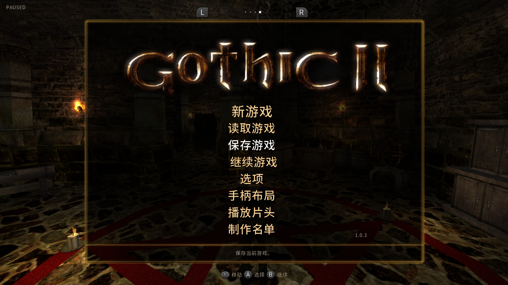
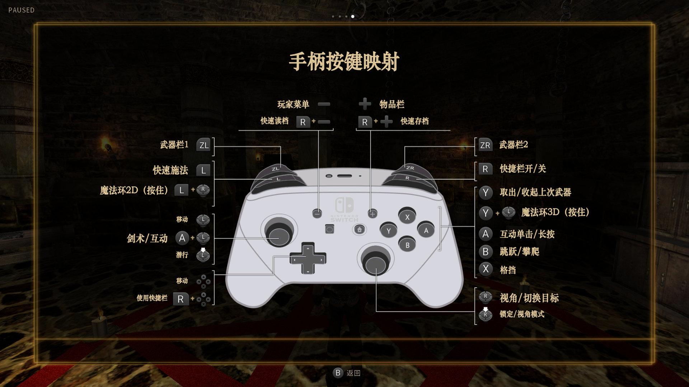
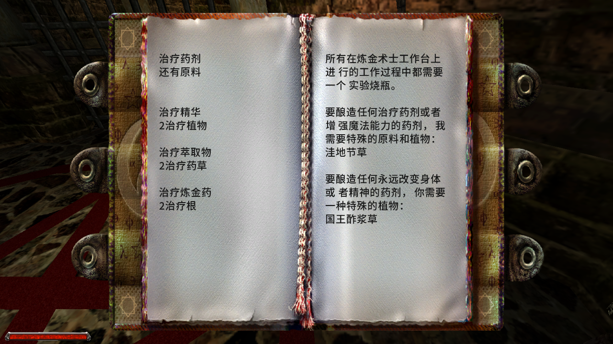
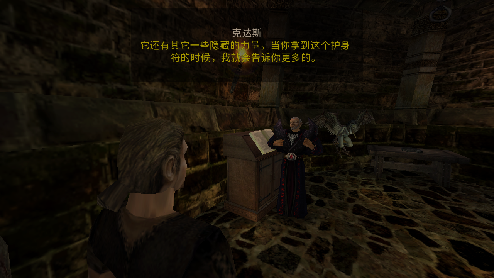
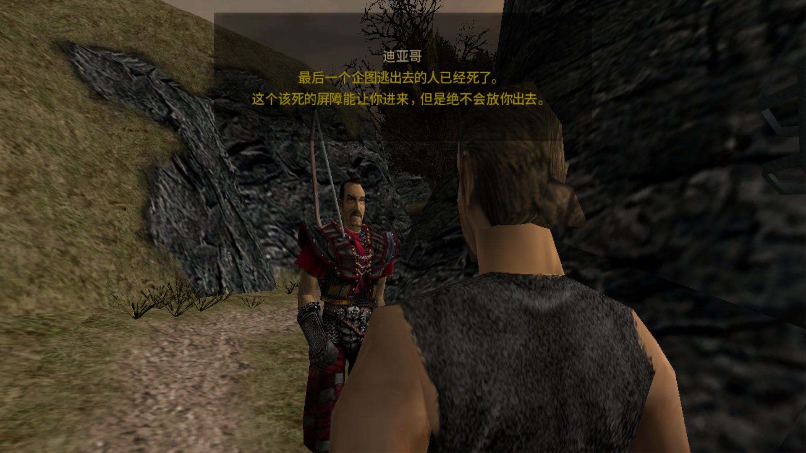
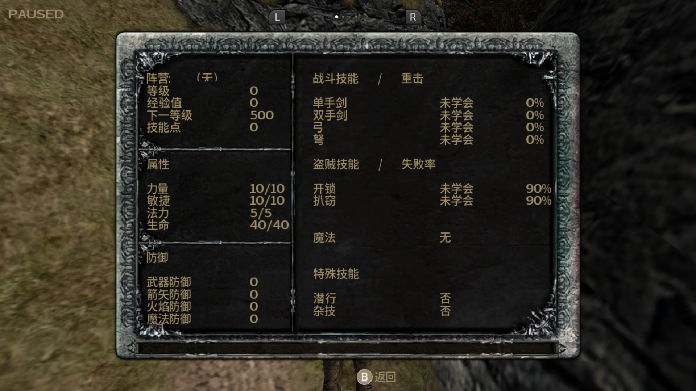
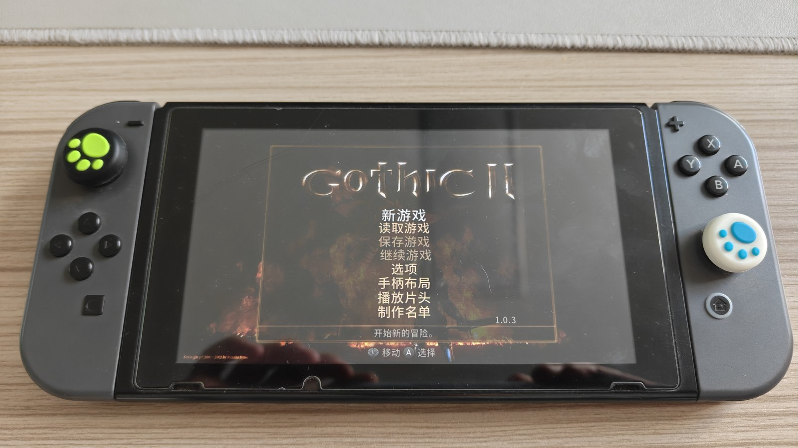
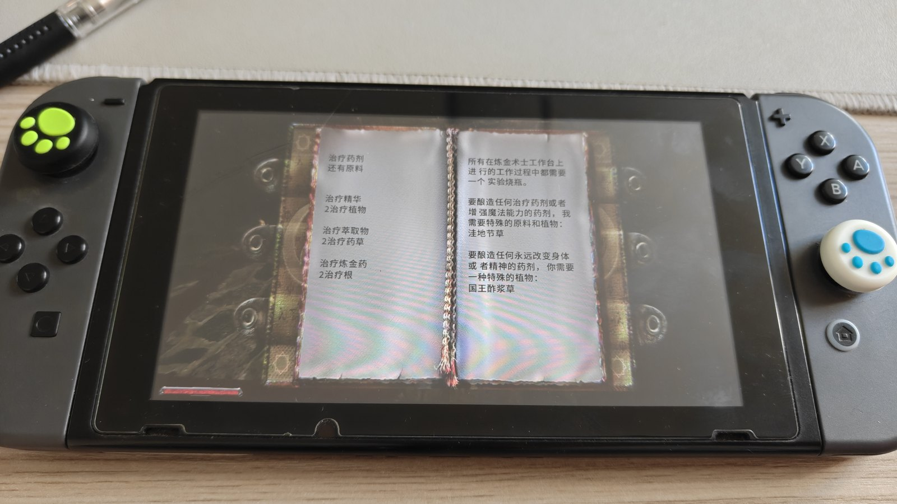

# 哥特王朝 1 / 2 经典版 · Nintendo Switch 简体中文汉化移植总结

> 我给自己留的一份施工记录：把哥特王朝 1、2 的 Switch 版改成简体中文，这一路做了什么、为什么这么做、哪里差点翻车。
> 状态：**两款游戏都已实机验证可用** —— 对话、主菜单、状态页、书籍页、字幕、体感设置页全部正常。
> 交付日期：2026-10-28 ｜ 文档整理：2026-10-30
> 写给谁：先写给我自己 —— 半年后忘了当初为什么这么改时，能查回来；也写给想做同类移植的人。
> 只想玩、不想看技术细节：**[文末有下载](#礼得清赞赏与下载)**（Gothic 1 汉化 MOD，G2 稍后）。

**TL;DR（英文摘要）**
We localized two Nintendo Switch ports of *Gothic* (a 2001-era engine, `_work/DATA` script assets, ZenKit-compatible `.DAT`/`.VDF` containers) into Simplified Chinese. The engine's `zCFont` hard-codes **256 glyphs indexed by a single byte**, which structurally cannot hold Chinese, so we binary-patched the game code itself: **121 patch sites in Gothic 1 (ARM32/A32)** and a separate patch set for **Gothic 2 v1.0.3 (AArch64)** — glyph indices widened to 16 bits, all inlined text-measurement loops rewritten to match, plus a custom 16-bit-LE text encoding that keeps ASCII mixed in at 8 bits. Fonts, script containers and cutscene subtitles were rebuilt byte-in-place (the `.VDF` container format refuses any restructuring). Both titles ship as a LayeredFS MOD *and* as a standalone slimmed NSP (Gothic 1: 3.34 GB → 1.51 GB, −55%; Gothic 2: ~11 GB → 4.25 GB, −58%).

**作者的话**

Gothic 是 2001 年的 RPG，Switch 版把两代都带上了掌机，唯独没有中文 —— 那就自己做。

这活看着像"换个字体"，实际上得从引擎的指令改起：它只肯认 256 个字形，简体中文要两千多个，于是我把字形索引硬改成 16 位，再把散在代码里二十几份的测宽循环一份一份对齐；两款游戏、两套指令集，各做一遍。改完引擎也不算完，字体、码表、脚本容器、过场字幕、按键图标，六层要一起对上；任何一层漏了，症状都不是"少一个字"，而是整片错字。

踩的坑比写的代码多。所以这份文档不只记"我做了什么"，更记"哪条路试过、走不通、别再试"—— 第 10 节 25 条硬结论、第 11 节 10 条黑名单，全是从实机翻车里捞出来的。如果它能帮你省掉一次"闪退 55 秒"的排查，就值了。

文末还有我顺手做的另一个小程序，跟汉化没关系；如果你觉得这份汉化有用，那里写了我最想要的回礼。

---

## 实机截图（先看效果）

> 前 6 张为模拟器原生分辨率截图（1920×1080 = 主机模式 / 1280×720 = 掌机模式），后 2 张为 Switch 真机屏摄。
> 图片随这份记录放在同级的 `images/` 目录，仓库里保持相对路径即可显示。

### Gothic 2 · 主菜单（1.0.3）



- 8 行菜单全部中文（含「手柄布局」一行），走 **B 组字体**（`gh=76 / fs=70`，`full_cell=True`）。
- 右下角版本号显示 **1.0.3** —— 由重打 control NCA 时改写 `control.nacp` 偏移 `0x3060` 的显示版本串得到（§8.2）。
- 主菜单本身**偏右**是原版版式（§6 最后一条），不是汉化造成的。

### Gothic 2 · 手柄按键映射页



- 这一页同时依赖 **扩槽后的 FNT** 与 **按键图标图集**（`Textures_NX.vdf` / `Patch0.vdf`）。
- 图标清晰度靠**增强 alpha**取得（引擎按「统一着色 × alpha」渲染、忽略 RGB，§6）；美术本身是原版。

### Gothic 2 · 书籍页（伪影修复后）



- **C 组字体**（`gh=45 / fs=36`，与对话同号），书页不再出现 `-` `&` `/` `!` `H` `J` `%` `$` `_` 一类伪影、行首不丢字、每行约 10 字。
- 这正是 §3.5「字节奇偶对齐」+ §3.6「静态数据存链接期绝对地址」两处修复的直接结果 —— 修之前这一页既闪退又满屏怪符号。

### Gothic 2 · 对话



- **A 组字体**（`gh=45 / fs=36`）+ 16 位中文与 8 位标点混排；说话人标题与正文同一套码表。

### Gothic 1 · 对话



- 定版 **A 组 `gh=50`**（v5+ 再缩 9%、字宽 ×0.909、空格统一 20），主机模式字距另走 +12% 分支（§3.1）。

### Gothic 1 · 状态页



- 左侧属性/防御、右侧战斗/盗贼/魔法/特殊技能：全部来自 **DAT 多行块整块译文**（行数与 `|` 段数必须一致，§5.2）。
- 数值列能对齐 = **测宽与绘制同构**（§3.3 铁律 A/B）成立；历史上这里偏右 110+ 就是因为只改了测量函数、漏了 25 份内联副本。

### Switch 真机屏摄




- 屏摄里的**彩虹纹/波纹是拍摄偏光屏产生的摩尔纹**，不是渲染问题；别和 §4.2 里 DXT3 写错压缩格式造成的 19 px 周期梳状伪影搞混 —— 后者在任何采集方式下都存在。

---

## 目录

→ 另见上方 [实机截图（先看效果）](#实机截图先看效果)

1. [问题的本质：为什么必须改引擎](#1-问题的本质为什么必须改引擎)
2. [六层架构](#2-六层架构)
3. [引擎层：字形索引 16 位化补丁](#3-引擎层字形索引-16-位化补丁)
4. [字体层：图集、FNT 与码表](#4-字体层图集fnt-与码表)
5. [文本层：数据资产与编码规则](#5-文本层数据资产与编码规则)
6. [图标层：按键图标与体感页](#6-图标层按键图标与体感页)
7. [流水线：顺序即正确性](#7-流水线顺序即正确性)
8. [部署与打包：MOD 与精简 ROM 两条路](#8-部署与打包mod-与精简-rom-两条路)
9. [验证方法论：怎么证明它是对的](#9-验证方法论怎么证明它是对的)
10. [硬结论清单（25 条，每条都有实证）](#10-硬结论清单25-条每条都有实证)
11. [踩坑黑名单（试过且失败，禁止重试）](#11-踩坑黑名单试过且失败禁止重试)
12. [已知遗留问题](#12-已知遗留问题)
13. [可迁移的通用经验](#13-可迁移的通用经验)
14. [公开发布的注意事项](#14-公开发布的注意事项)
15. [附录 A：交付物与校验值](#附录-a交付物与校验值)
16. [附录 B：常量与术语表](#附录-b常量与术语表)
17. [附录 C：复现指引](#附录-c复现指引)

→ 文末：[礼得清、赞赏与下载](#礼得清赞赏与下载) ｜ [许可与免责](#许可与免责)

**怎么读这份记录**

- 只想装上玩 → 直接跳[文末下载](#下载gothic-1-汉化-mod2026-10-28-定版)
- 想知道是怎么改出来的 → 第 3～6 节（引擎 / 字体 / 文本 / 图标）
- 想自己复刻一版 → 第 7 节流水线 + 附录 C
- 想避开我踩过的坑 → 第 10、11 节（25 条硬结论 + 10 条黑名单）

---

## 1. 问题的本质：为什么必须改引擎

引擎里字形索引是**一字节 = 一个 256 项 `widths[]` 表的下标**，图集 UV 数组同样按 256 项铺开。简体中文最少需要 2000+ 字形，单字节装不下。

| 方案 | 可行性 | 结论 |
| --- | --- | --- |
| 只换字体、不动引擎 | ❌ | 256 槽放不下常用字；多字节序列还会被按单字节切碎 |
| 数据侧「一字节一码位」分页 | ❌ | 单字节表达不了 2000+ 字；`widths[256]` 是死的 |
| **引擎补丁：字形索引扩到 16 位** | ✅ | **采用**。G1 = 121 处，G2（1.0.3 AArch64）另出一套 |

一句话概括工程性质：**这不是"换皮"式汉化，是给闭源二进制做指令级改造 + 自建一套文本编码 + 重建全部相关资产**。任何一层的改动都会传导到其它五层，所以第 2 节那张分层图，是我整个工程最重要的心智模型。

---

## 2. 六层架构

```
① 引擎（exefs/main）        121 处 ARM32 补丁：字形索引 16 位化 + 测宽/绘制同构 + 图标/字体加载
        ↓ 决定「怎么读字符、怎么查宽度」
② 字体（textures_font_*.vdf） 图集 + FNT（gh / widths / UV），码表为唯一真源
        ↓ 决定「字形长什么样、字宽多少」
③ 码表（codemap.json）        字符 → 槽号（V = BASE + 槽），全项目唯一真源
        ↓ 决定「DAT 里写的 16 位值对应哪个字」
④ DAT（GOTHIC/MENU）+ OU.BIN  按符号名替换文本值，长度可变（索引表存符号序号，不用回填偏移）
        ↓ 承载全部对话 / 菜单 / 物品名 / 字幕
⑤ 文本编码约定                u16 小端 + 8 位 ASCII 混排 + 单字节 0x0A / 0x7C 分隔
        ↓ 决定「引擎能否正确切分 / 换行 / 取值」
⑥ 图标（INPUT_NXBUTTON 等）    原版美术 + alpha 增强（引擎只认 alpha）
```

**改任何一层，必须连带核对相邻层。** 例：加一个译文新用字 → ①码表加槽 → ②重跑字体（**必须冻结已有槽位**）→ ③重建 DAT → ⑤检查新槽低字节是否踩禁忌值。这条链上漏一环，症状是"整片错字"而不是"少一个字"，极易误判。

> 下文按层展开：§3 = 层①，§4 = 层②③，§5 = 层④⑤，§6 = 层⑥。

---

## 3. 引擎层：字形索引 16 位化补丁

工具链：`capstone`（反汇编）+ `keystone`（汇编），逐条**校验原指令字节是否等于预期**，不等就中止 —— 不允许"盲改"。补丁以「地址 + 原指令 + 新指令 + 说明」表驱动，同一份表既能打也能 `--verify`（只读重放比对）。

### 3.1 补丁分组（Gothic 1，121 处）

| 组 | 处数 | 内容 |
| --- | --- | --- |
| FNT 加载器 ×2 | 8 | `widths` 读 256→`0xD00` 字节；UV 区搬到 `+0xD20`，交错 16 B/字形 |
| 字体对象构造 ×5 | 10 | `new/memset` 尺寸 `0x1120 → 0xDD20`（少改一个 ⇒ 堆溢出崩溃） |
| 渲染循环 ×2 | 12 | `ldrb→ldrh` + `0xD00` 分类 + 8 位回退 + UV 索引 `×8→×16` |
| 转义前缀判定 ×3 | 6 | `$`/`~` 帧码判定改走跳板（否则体感动画渲染成文字） |
| **测宽循环 ×25** | 75 | 每簇 FIRST/INIT/STEP 三点改跳板（Fix C，见 §3.3） |
| 其它 | 10 | 取消 `glyphCount==256` 校验、UV 偏移、`|` 分隔符步进等 |

定版又在同一条管线上加了 **46 个「字距」站点跳板**：首次绘制时调用 `nn::oe::GetOperationMode`，把掌机/主机模式缓存到 data 段尾部空隙，按模式选「原值」或「放大值」—— 主机模式字距 +12%，掌机模式逐字节不变。测宽与绘制**同源同改**，所以放大后居中不跑偏。（代价：切换掌机/主机需重启游戏，模式只读一次。）

### 3.2 对象布局与**指令编码硬上限**（Gothic 2 常量表）

| 项 | G1（ARM32） | G2（1.0.3，AArch64 与 ARM32 各一套） |
| --- | --- | --- |
| 基址 `BASE` | `0x100` | `0x100` |
| 总容量 `M`（FNT header `count` 必须写它） | `0xD00` = 3328 | `0xF00` = 3840 |
| CJK 槽区 `N`（`M - BASE`） | 3072 | 3584（**零余量**） |
| `widths` 偏移 | `+0x20` | `+0x20` |
| `UV` 偏移 / 字节数 | `+0xD20` / `0xD000` | `+0xF20` / `0xF000`（交错 16 B/字形） |
| 对象尺寸 | `0x1120 → 0xDD20` | `→ 0xFF20`（`memset` 长度 `0xFF04`） |
| 8 位回退阈值 | `V ≥ 0xD00` | `V ≥ 0xF00` |

⚠️ **容量不是想扩就能扩**。ARM32 下对象尺寸由单条 `movw r1, #imm16` 表达 ⇒ `M ≤ 0xF05`；`widths`/`UV` 寻址受 `ldr [rX, #imm12]` 限制 ⇒ `M ≤ 0xFD3`。我曾把 `N` 从 3072 试扩到 3584（24 处改动），主菜单整体不出字；回退后症状不变，才证明 `N` 不是根因 —— **先证伪，再动手**。

### 3.3 两条实现铁律（这两条各埋过一次"闪退 55 秒"的血案）

**铁律 A：测宽循环必须「每簇独立内联」，绝不可共用跳板。**
编译器把测宽循环内联了几十份（G1 = 25 份，G2 = 24 份），寄存器组合只有 13 种 F / 8 种 S。若为省空间让它们共用一个 trampoline，跳板末尾的 `b` 只能回填**一个**返回地址 ⇒ 其余簇返回到错误位置 ⇒ PC 飞进堆 ⇒ 55 秒闪退（`SP/FP/LR = 0`）。
正确做法：每簇 3 个点**原地替换** —— `ldrb rX,[rY]`→`ldrh`；`add rt,rn,#1`→`#2`；`ldrb rX,[rY],#1`→`ldrh rX,[rY],#2`；`widths` 读取的 `ldrb [rX,#0x20]` 不动。

**铁律 B：测宽循环的终止判据要从 `cmp rX,#0` 改成 `tst rX,#0xff`（41 处）。**
16 位读取下，串尾的 `00 0A` 读出来是 `0x0A00 ≠ 0` ⇒ 循环不会在串尾停下，会越过终止符继续累加宽度。这是"文本偏右/换行错乱"类症状的真正来源。

### 3.4 Gothic 2 的架构反转：ARM32 → AArch64

G2 第一轮做完 103 处补丁（79 + 测宽 24×3 内联），加终止判据修正共 144 处，一切正常 —— 直到装上官方 v1.0.3 更新，**启动 3 秒崩溃**。根因：基础版本的 `main` 是 4,646,824 B 的 **ARM32**，而 1.0.3 的 `main` 是 4,247,401 B 的 **AArch64**（发行方换成了 `NX64` 渲染器构建）。**整套补丁表按 ARM32 写的，一条都不能复用**，指令宽度、寻址方式、立即数编码全变了。

教训：**先确认目标二进制的确切版本与架构，再开始写补丁表。** 检查方法极简 —— 文件大小 + 首条指令 + 段表；AArch64 与 ARM32 的反汇编一眼可辨。把"版本对齐"放在流程第 0 步，比事后重做省一个数量级的时间。

1.0.3 这条线的补丁 = 基础 16 位化补丁 + Fix C（**96 处补丁 / 24 段跳板**，逐条 `--verify` 失败 0）+ 书籍页包装函数改造（§5.4）。

### 3.5 字节奇偶对齐：16 位文本经过任何「按字节处理」的中间层都会错位一格

书页出现过一批看似随机的伪影（`-` `&` `/` `!` `H` `J` `%` `$` `_`）。反证如下：引擎内部**按字节**扫描分词，16 位文本被切成 token 后，在边界丢 1 字节、又补 1 字节空格 ⇒ 后续字符的**字节配对偏移一格** ⇒ 渲染循环取到一个错误的 u16，其值 ≥ 回退阈值 ⇒ 走 8 位回退画出那个垃圾字节的 Latin-1 字形（"炼"→`-`、"工"→`&`、"台"→`/`……）。零散伪影、偶发丢字，全是同一个机理：**任何按字节处理 16 位文本的中间层，都必须成对（±2 字节）操作，否则配对一乱就整片串位。**

修复方向不是"猜哪个字节错了"，而是让配对**恒为偶数**：去掉 token 边界补空格、长度不再 `+1`、分隔集缩成只剩 `"\n"`、把另一组空白集指向自造的确定内容，必要时在 DAT 里预折行（行尾插 `0A 0D`：LF 触发独立换行 token，CR 不计词被跳过 ⇒ 下一 token 从行首字符开始且长度为偶）。补丁点（AArch64，节选）：

| VA | 原指令 | 改为 | 作用 |
| --- | --- | --- | --- |
| `0x30D2A0/0x30D2A4` | `mov w8,#0x20` / `strh w8,[x25,x0]` | `nop` | 去 token 边界补空格（主路径） |
| `0x30D47C` / `0x30D6A4` | `add x8,x8,#1` | `add x8,x8,#0` | 去累加长度 +1 |
| `0x30CFAC` / `0x30CFCC` | `add x8,x8,#0x90f` / `mov w8,#0x15` | `#0x923` / `#1` | 分隔集 A 指针改指 `"\n"`、长度 21→1 |
| `0x30D0CC` / `0x30D0FC` | `adrp x23,#0x6f7000` / `ldr x23,[x23,#0xd88]` | `#0x5cf000` / `add x23,x23,#0xf28` | 分隔集 B 改指向 text 段洞里自造的确定字符串 |

### 3.6 另一类引擎坑：静态数据里存了链接期绝对地址

"阅读书籍"必崩。崩溃日志：`PC = strlen`，`Invalid memory access @0x5CF000`，模块基址 `0x8504000`。
根因：书籍多行包装用的一个"假对象"（setB）在**静态数据段里直接存了指针的链接期绝对地址**。NSO 由加载器随机基址映射，这个值不会被重定位 ⇒ 分词器拿它做 `strlen` 就读到未映射页。
修法：不在静态数据里存地址，改为**运行期 stub 现场构造 + PC 相对取址**（`adrp/add` 算出运行时地址再写入对象）。
通用结论：**在二进制里"手写"指向代码/数据的指针，必须走 PC 相对 + 运行期填充；直接写死 VA 在 base≠0 的加载模型下必炸。**

---

## 4. 字体层：图集、FNT 与码表

### 4.1 字体组

原版不是一套字体，而是按字号/用途分成多组，**每组都要重建**（漏一组 = 那个界面整片不显示）。

| 组 | 用途 | G1 | G2 |
| --- | --- | --- | --- |
| A | 对话 / HUD / 状态页 | `gh=50`（定版再缩 9%，字宽 ×0.909，空格统一 20） | `gh=45 / fs=36` |
| B | 主菜单 | `gh=76 / fs=70`，`full_cell=True` | 同（`gh=76 / fs=70`） |
| C | 书籍 | `gh=38` | `gh=45 / fs=36`（与对话一致） |
| D | 底部提示 | `gh=27 / fs=20` | `LEGENDS gh=71`，`full_cell=True` |
| a/b | 低清版 | — | `gh=18` / `gh=35` |

G1 共 13 FNT + 13 TEX，G2 共 22 FNT（自检：`count=3840`、非法 UV 0 个、非空字形 2939）。

### 4.2 FNT / TEX 格式要点（每条都被踩过）

- FNT 头：`"1\n" + image名 + "\n" + u32 gh + u32 count + widths[] + UV[]`。
  **`count` 必须写 `M`**（3328 / 3840），写 256 会走原版分支 ⇒ UV 全垃圾 ⇒ 界面空白。
- `widths[]` 按**码值 `V` 本身**索引（引擎读 `widths[V]`、`UV[V*16]`，原版就是 `widths['A']`），
  早期按"槽位号 `V-BASE`"写 ⇒ 整表错位 `0x100` ⇒ 每个字都画成别的字。**这是整个工程最隐蔽的一个 bug。**
- 低区（ASCII + Latin-1 全量）必须**回填**：8 位回退路径按字节取，复用同一图集格。
  漏了低区，DAT 资源槽里的 `$*QYZqx`、`#$%` 一类控制串会报"缺失字"。
- `cell ≡ glyphHeight`：引擎按 **1 纹素 = 1 虚拟单位**采样，**忽略 UV 跨度** ⇒ 图集格子必须与字高一致。
- `widths` 必须用 **advance**（PIL `font.getlength(ch) + 2×stroke`），不是墨迹宽。
  用墨迹宽 ⇒ `i` 宽 3、空格宽 0 ⇒ 字母互相压叠。UV 取"宽度 = advance 的居中条带、v = 整格"，保证 quad 与纹素 1:1。
- `full_cell=True` 的组（主菜单 B / LEGENDS D）UV 必须取**格子矩形**；写成 `0,0,1,1` ⇒ 每个字都是整张图集被压进一个小方块。
- TEX 是 ZTEX，`format=12` = **DXT3/BC2**（不是 DXT5！）；块解码 `reshape((h//4,w//4,4,4)).transpose(0,2,1,3).reshape(h,w)`，编码要 `exact_color=True`。写错压缩格式的症状是 19 px 周期的梳状伪影。
- 图集尺寸取 2 的幂（4096×2048 可容 4095 槽 ≥ M）。

### 4.3 码表（codemap）= 全项目唯一真源

- 字符 → 槽号，`V = BASE(0x100) + 槽`。规模：G1 **2366 字**（`filler=0x0CFF`，宽 0 不可见），G2 **2941 项**（`filler=0x0EFF`）。
- ★ **字体重建必须冻结码表**（环境变量 `G1_REUSE_CODEMAP=1`）。重算码表 ⇒ 个别字换槽 ⇒ 已部署的 `MENU.DAT` 整片错字。
- ★ **已部署的 `MENU.DAT` 不能重建**（它与字体图集一一配套）。码表只能冻结，不能重排。
- 槽位分三池（OU 与 DAT 各要满足各自的字节禁忌）：`both` / `dat_only` / `ou_only`；
  `dat_only` **只能取 OU 侧本来不可用的槽**（低字节 `0x2F` 或高字节 `0x09`），否则挤占 OU 池（实测缺 168 个槽）。
- 字体改动走**原位重排**（以已部署 VDF 为基线，只换目标条目、其余逐字节搬运），**不要整包重建** —— 整包重建会把 B/C/D 组拉回代码默认值，实机表现为"我没改的界面字体也变了"。

---

## 5. 文本层：数据资产与编码规则

### 5.1 编码规则一览

| 情形 | 字节 | 引擎行为 |
| --- | --- | --- |
| 中文字形（高区槽） | `[槽低字节, 槽高字节]` u16 小端 | 16 位码，步进 2 |
| 8 位 ASCII（英文/数字） | 单字节 | 读 u16 后 `V ≥ M` ⇒ 取低字节，**净步进 1** |
| 空格 | u16（`V=0x120`） | 正常字形；`widths[0x20] == widths[0x120]`（测量读低区/绘制读高区，不等 ⇒ 整行偏右） |
| 串终止 | `00 00` | NUL 对 ⇒ 测量终止 |
| 多行 / 选项分隔 | **单个** `0x0A` / `0x7C` | 引擎按字节扫描切分 |

**两条铁律（违反即整片错字/乱码）：**

1. 码表里**不能有** `槽 & 0xFF ∈ {0x00, 0x0A, 0x0D, 0x7C}` 的字形 —— 低字节会被当成串终止符或分隔符。
2. 字形槽不能是 `0xX00`（低字节 0）—— `strlen` 系路径会截断、NUL 判定会误杀。

G2 的 `M = 3840 = N + BASE` **零余量**，所以"把会碰撞的码位排除掉"这条路走不通，只能在**分配阶段**按禁忌值筛槽；高字节也被刻意限制（只用 `1..9,b,c,e`，避开 `0x0A/0x0D`）。

### 5.2 DAT（GOTHIC.DAT / MENU.DAT）

- 结构：`ver(0x32) + u32 N + N×u32 名序索引 + 符号记录区 + 字节码`。
- 记录：`FF FF FF FF 01 00 00 00` + NAME + `\n` + `00 00 00 00 01` + 23 B 头 + TEXT + `\n`。
- ★ **索引表存的是符号序号、不是字节偏移** ⇒ 替换后长度变化**无需回填偏移**，可以按槽位偏移直接换。
- ★ **符号名区（NAME）绝不可 16 位化** —— 它也是"串"，16 位化直接损坏符号表 ⇒ 空指针崩溃。
- ★ **定位用符号名，禁止 `find(英文原文)`** —— 译文里可能复用了同样的英文片段，会命中错误记录。
- ★ **MENU.DAT 的匿名槽（`$NNNNN`）值是菜单结构引用**，翻译它 = 断引用，必须加防护白名单。
- ★ **含 `|` 的选项列表槽不可译成中文**：引擎按单字节 `0x7C` split ⇒ 16 位中文段会让分段错位 ⇒ 触发" `-` 空指针"崩溃。
  规则：多段选项必须"每段各自 16 位 + 段间单字节 `0x7C`"，整串 16 位化则 split 失败。
- 多行块（技能名/数值/公会名/法术说明）用整块译文表处理：**行数必须一致、`|` 段数必须一致**。
- 基版本对齐：G2 换到 1.0.3 后必须以 1.0.3 的 DAT 为基底（符号交集 61,143，新增 44 个符号），
  不能拿旧版译文表直接套。规模：G1 37,650 符号（GOTHIC 覆盖 99.9%、MENU 100%）；G2 中文槽 GOTHIC 28,838 处、MENU 173 处。

### 5.3 OU.BIN（过场字幕）

- 可以**扩容**：槽结构 `u16 len + data`；头部尺寸字段（`END\n` 之后的 u32）= 文件长 − (字段偏移 + 8)。
- 槽终止判据 = 后一个字节 ∈ `{0x00, 0x0A, 0x12}` ⇒ **填充字节禁用 `0x00`**。
- 规模：G1 7,471 块 100%；G2 两万余块（配对校验 20,808 / 20,817，块名序列一致）。
- 字幕里的"补字"要在**槽位级**插入，不能改文本长度字段以外的东西（G1 就靠这个修好了 PC 汉化源漏掉的"戈麦斯"首字）。

### 5.4 书籍页 = 一个独立的引擎子系统

书页走的是"多行包装函数"（唯一调用者按 view 名分发 `SetText`/`PrintMultiline`）：拷输入串 → 末尾追加 2 字节 LF → 循环调分词器 → 逐 token 测宽 → 超限就推行。它的分隔集来自 rodata 的一张 21 字节表和**运行时初始化**的全局空白集（含 `0x09 TAB`、`0x0D CR`）。
⇒ 结论：**"汉化后书籍页出现伪影"不是字体问题，是这个子系统按字节工作**。修法见 §3.5；修完每行约 10 字、无伪影、不丢字。
左侧目录页走单行兄弟函数，所以没有伪影 —— 这个"只有右页坏"的对照，是定位到包装函数的关键线索。

### 5.5 语言槽策略（8 语言下拉全部可用）

引擎的语言索引来自**存档里的 `gothic.ini [GAME] language=<n>`**（不在 romfs），索引序 `0→EN 1→DE 2→PL 3→RU 4→FR 5→ES 6→IT 7→CZ`。
做法：**位置 0（`SCRIPTS_EN`）= 中文**，位置 1–7 = **英文 16 位版**（不是原版 8 位文本！）。
原因：引擎已只认 16 位字模，槽位缺失时回落到本体里的 8 位原文 ⇒ 碎字。所以"兜底槽"必须装**已经 16 位化的英文**，而不是原文。
副作用与代价：非 EN 槽里装的是英文内容而非对应语言 —— 这是设计选择（保可用），不是遗漏。

---

## 6. 图标层：按键图标与体感页

- 按键图标图集（`INPUT_NXBUTTON`）与原版**逐字节一致**。"看不清"不是因为美术差，而是因为**引擎按「统一着色 × alpha」渲染、忽略 RGB** ⇒ 提升可读性的唯一入口是**增强 alpha**（`G1_ICON_ALPHA=1` 烘焙）。
- 源 FNT 的 `count=256` 但数据实际有 N 槽 ⇒ UV 全 `(0,0)`；图标槽从 `0x21~0x30` 重映射到 `0x2E0~0x2EF`。
- 体感页（手势动画）：转义 `$帧码$` / `~` 的判定必须用 `ldrb` 读**低字节**；被误改成 16 位读 ⇒ 帧码不触发 ⇒ 动画被当文字渲染。**"体感页空白"的另一半真因**是 NX 字体 FNT 的 `count` 被写成 256（应为 `M`）。
- 语言包 VDF 多塞条目 ⇒ 字体加载失败并退默认字体 ⇒ 把 16 帧写进 `cp125x` 的 `MOTION_CONTROL.FNT`，而不是往 VDF 里加新条目。
- 版式对照："菜单没居中"要先看原版 —— **原版主菜单本身就偏右 +144 px**，不是汉化的锅。重绘贴图先做"文字/图标分离"再擦。

---

## 7. 流水线：顺序即正确性

```bash
PY=.../python.exe            # 需 numpy / Pillow(+freetype) / capstone / keystone / zenkit

# ① 引擎（★ 最先，产出 main 与 M/N 常量）
python tools/g1_engine_patch.py                      # G1：121 处
G2_LAYOUT=103 python g2u103_engine_patch.py          # G2：1.0.3 AArch64 线
# ② 字体（★ 必须冻结码表；G2 必须指定基底版本布局）
G1_REUSE_CODEMAP=1 G1_A_FS=24 G1_C_FS=24 G1_D_FS=20 python tools/g1_font_build.py
G2_LAYOUT=103 python g2_font_build.py
# ③ 文本：DAT + 字幕；再做英文 16 位兜底槽
python tools/g1_dat_rebuild.py && python tools/g1_ou_patch.py
python g2_dat_rebuild.py && python g2_dat_encode.py && python g2_ou_patch.py
# ④ 自检（引擎逐条反汇编比对 + 字体 + 宽度一致性 + 方块字几何）
python tools/g1_selfcheck.py && python g2_engine_patch.py --verify && python g2u103_engine_patch.py --verify
# ⑤ 部署（LayeredFS）→ 实机看画面 → 才允许打包
python tools/g1_deploy.py
```

顺序不能换的三个理由：②需要①的 `M/N` 常量；③需要②的码表；⑤的产物必须与实机验证过的那棵树**逐字节一致**（打包时禁止顺手"重新生成一遍"）。
整条链上的关键开关都保留为环境变量（`G1_REUSE_CODEMAP` / `G1_NO_ML` / `G1_ICON_ALPHA` / `G1_DOCK_BOOST` / `G2_LAYOUT`）—— 这是"能一键回退到上一个已知良好状态"的最便宜实现。

**VDF 覆盖点清单（最容易漏的就是这里）**：字体不止一处。G2 实际要改 **四处**：
`Data/cp125{0,1,2}/textures_font_*.vdf` + `Data/Textures.vdf` + `Data/Textures_NX.vdf` + **`Data/Textures_Addon.vdf`（168.7 MB，含 9 FNT + 9 TEX，极易漏）**（`Textures_Addon_NX.vdf` 无字体）。
★ **VDF 容器结构绝对不能动**：改条目类型 / 头部 `nf` ⇒ 启动即闪退。只能**原地改字节**；同名条目的载荷可以共享数据偏移（原版就这么省体积）。`Textures.vdf` 的 2545 个目录项**非升序 ⇒ 禁止排序**。

> 交付包（MOD 11/10 文件）是按"与目标树的差异"挑的，并不等于上面这张覆盖清单的每一条都要进包 —— 例如精简 ROM 已自带全部改过的 VDF，而 MOD 只带必需子集。
> 因此换字体后**必须逐界面用画面验证**，不能只信清单；我遇到的"某个界面还是碎字"类问题，全都出在覆盖点被漏掉。

---

## 8. 部署与打包：MOD 与精简 ROM 两条路

### 8.1 路线一：Atmosphere LayeredFS MOD（可随时摘除）

- 目标目录 `atmosphere/contents/<TID>/exefs|romfs/...`，改哪个文件换哪个文件。
- 交付档位（同一套工具不同裁剪档）：

| 档位 | 文件数 | 体积 | 说明 |
| --- | --- | --- | --- |
| G1 完整 | 30 | 355.5 MB | 8 语言槽 + 三套 cp125x 字体 |
| G1 `--min` | 10 | 241.0 MB | 中文 + 英文档（交付即用） |
| G1 `--zh-only` | 7 | 234.7 MB | 纯中文 |
| G2 交付 | 11 | ~386 MB（zip 93.9 MiB） | 中文 + 英文档 + 引擎/字体/贴图 |

- 摘除 = 删掉 `contents/<TID>/` 一棵子树，游戏回原版。**不动系统文件。**
- ⚠ MOD 路线必须写清"依赖关系"：G2 的 MOD 依赖**官方 v1.0.3 更新包**提供 1.0.3 引擎；而精简 ROM 路线要求**先卸载**该更新包（否则更新包里的原版引擎覆盖已汉化引擎 ⇒ 汉化回英文）。两者相反，说明里必须显式强调。

### 8.2 路线二：精简 ROM（重打 NSP，装完即中文，无需 MOD）

只删语音就能省一半以上体积：

| | 原版 | 精简后 | 删了什么 |
| --- | --- | --- | --- |
| G1 | 3.34 GB | **1.51 GB（−55%）** | `de/pl/ru` 三个 `speech.NX.VDF`（645+638+729 MB ≈ 2.05 GB） |
| G2 | 本体 9.99 GB + 更新 1.01 GB ≈ 11 GB | **4.25 GB（romfs 10.03 → 4.21 GB，−58%）** | `de/pl/ru` 语音 + `cp1250/cp1251` 字体包，共 11 文件 ≈ 5.89 GB |

打包四步（`hacPack`，`--keygeneration 16` 与原版一致；program 用 `--sdkversion 0F030200`，control/meta 用 `0F030000`，program 必带 `--nologo`）：

```
① 重建 program NCA（exefs + 精简 romfs）
② 重建 control NCA（改版号时改 control.nacp 偏移 0x3060 的显示版本串）
③ 用新 program + 新 control + 原 legal 生成 meta(cnmt) NCA（--titleversion 00030000 = 官方 1.0.3）
④ 组装 NSP（ncadir = 新 program + 新 cnmt + 新 control + 原 legal）
```

踩到的坑，全部记下来：

- **hacpack 的 SDK 版本校验上界**要 patch，否则新版 SDK 串直接报错（本仓库不分发 patch 后的二进制）。
- **hactool / hacpack 不支持中文路径**（空格可以，中文不行）；ZenKit 用 cp1252 解路径 ⇒ 中文路径报错。⇒ 打包目录必须 ASCII。
- **精简 romfs 的空目录**：删掉 de/pl/ru 语音后这三个目录变空。原版 romfs 里没有空目录 ⇒ 每个空目录放 1 个 9 字节占位文件（`g1fix.txt`），最贴近原版行为，避免实机 romfs 驱动枚举异常。⇒ 文件数 110 → 113。
- **改版号要让玩家看得见**：把 control 的显示版本与 meta 的 `titleversion` 一起对齐到 1.0.3，主菜单右下角与模拟器库都显示 1.0.3，玩家不会误以为还要装更新。
- **原版 NSP 不含 ticket/cert**（G2 的 PFS0 里只有 3 个 NCA + cnmt 共 5 项）⇒ 本包同样不含，模拟器直接可跑；真机安装以原版本体的安装方式为准。
- PFS0 布局（用于从归档 NSP 里取回 control/legal 等部件）：
  `hdr(16) = 'PFS0' | filecount u32 | strtab_size u32 | reserved u32`；`entries = cnt × 24`（`offset u64 | size u64 | name_off u32 | ext u32`）；数据区基址 = `16 + cnt*24 + strsz`。
- **romfs 树禁止「硬链接 + `cp -f`」**：`cp` 会穿透 inode 直接改写源文件，把 9.3 GB 的基线 romfs 改掉。构造精简树时，未改动文件用硬链接、被改动的文件必须**真实复制**。

### 8.3 模拟器侧的两条硬规则

- ★★★ **换过 `main` 或字体后必须删 Ryujinx 的 shader/PPTC 缓存**（`%APPDATA%/Ryujinx/games/<TID>`），
  否则启动 3 秒崩在 `nnrtld:0x8f4`（Invalid access）—— 这个栈跟"引擎补丁有 bug"长得一模一样，**排查时先清缓存**。
- 精简 ROM 是基座标题的完整本体 ⇒ **模拟器里不能再叠加官方 1.0.3 更新**：两套 romfs 合并约 9.5 秒崩
  `ResultFsNonRealDataVerificationFailed (2002-4604): Hash error!`。解法：右键游戏 →「管理更新」取消勾选，或删 `games/<TID>/updates.json`。

---

## 9. 验证方法论：怎么证明它是对的

"能跑起来"不等于"对"。我所有交付都过下面这套，**每一条都能证伪**：

| 手段 | 做法 | 它挡住什么 |
| --- | --- | --- |
| 补丁表 `--verify` | 表驱动，同一份表既能打也能只读重放，逐条反汇编比对原字节 | 打错地址 / 版本漂移 / 重复打 |
| 等价性仿真 | 用 Python 镜像"测宽"与"绘制"两条语义，跑上千条真实串（G2：1,047 条 MENU + 38,933 条 GOTHIC × 25 张 widths 表），断言**新测宽序列 == 绘制可见前缀** | 偏右 / 换行错 / 越过串尾（历史失败主因） |
| 二进制逐字节 diff | 原版 `main` vs 部署 `main`，**只允许预期区间变化** | 意外改写、越界填充 |
| 容器层校验 | `hactool -y`：program NCA 的 IVFC Level 0–5 全 GOOD、cnmt superblock/hash table GOOD、control/legal GOOD | 重打 NSP 的结构破损 |
| 回读校验 | 解包新 NSP，逐文件 md5 对比部署清单（G1 113 romfs + 6 exefs；G2 222 romfs + 7 exefs，0 异常） | 打包漏文件 / 打错文件 |
| 符号数不变 | ZenKit 读回 DAT，断言符号总数与原版一致（37,650 不变） | 结构损坏、记录错接 |
| 部署树 == 打包源 | `build/mod` ↔ 实机验证过的 Ryujinx 树逐字节比对（30/30） | "打包用的是旧产物"这个隐形错误 |
| 离线渲染 +  IoU 反查 | 把图集格渲染成位图与截图对比；字形 IoU 反查"这个字到底是谁" | 表错位、UV 写错 |
| 截图规范 | 必须原生 1920×1080（960×540 会造出伪影，把缩放当成 bug 追） | 误判 |

**对照实验是最强工具**：关掉新改动重建，若产物精确等于上一版部署 ⇒ 差异只可能来自本次改动。我 6 次误判全靠这类对照纠正。

---

## 10. 硬结论清单（25 条，每条都有实证）

G1（①–⑳）与 G2（㉑–㉕）。**别再重新调研这些，直接采用。**

| # | 结论 |
| --- | --- |
| 1 | 主菜单"每行只剩 1 个字母" = `gothic.ini` 的 `language` 索引指向了原版 8 位语言包 |
| 2 | 引擎有**两个** FNT 加载器（`0x398338` / `0x399f84`），漏一个 ⇒ 小字号字体整片不显示 |
| 3 | `zCFont` 对象尺寸有 **5 组构造器**（`0x1120→0xDD20`），必须同步放大，否则堆溢出崩溃 |
| 4 | ZTEX `format=12` 是 **DXT3/BC2**（不是 DXT5）—— 写错 ⇒ 19 px 周期梳状伪影 |
| 5 | 引擎按 **1 纹素 / 1 虚拟单位**采样、**忽略 UV 跨度** ⇒ 图集格子必须 `cell == glyphHeight` |
| 6 | 屏幕缩放 `s ≈ 0.78`：quad 像素 = `gh × s`，字模墨高 ≈ `fs × s`（主机模式另有倍率） |
| 7 | 测宽循环被编译器**内联 25 份**，只改"测量函数"9 处 ⇒ 偏右 110+（历史失败根因） |
| 8 | 测量与绘制**每字公式相同**，唯一差异是字符读取方式 ⇒ 两边同构即 `measured == drawn` |
| 9 | 测量含"每字 ~2 px spacing"，故 measured 略大于 drawn —— 原版英文同样如此，属原生行为，别去"修" |
| 10 | 多行串（内嵌 `0x0A`）被槽扫描截断成"只剩最后一行" ⇒ 状态页技能名/数值/公会名整片英文 |
| 11 | DAT 数据块属于**它后面那个 PFX 的符号名**；索引表存**符号序号**不是字节偏移 ⇒ 改长度无需回填 |
| 12 | MENU.DAT 的匿名槽（`$NNNNN`）值是**菜单结构引用**，翻译会断引用 ⇒ 必须防护 |
| 13 | `|` 选项列表必须"每段各自 16 位 + 段间单字节 `0x7C`"，整串 16 位化会 split 失败并崩 |
| 14 | 转义 `$帧码$`（体感手势动画）判定必须用 `ldrb` 读低字节，纯 `ldrh` ⇒ 动画变文字 |
| 15 | 体感页空白真因 = NX 字体 FNT 的 `count` 写成 256（应为 `M=3328`） |
| 16 | 按键图标图集与原版逐字节一致；不清晰是因为引擎按「统一着色 × alpha」渲染（忽略 RGB） |
| 17 | 字体重建**必须冻结码表**（`G1_REUSE_CODEMAP=1`），否则个别字换槽 ⇒ MENU.DAT 整片错字 |
| 18 | 已部署的 MENU.DAT **不能重建**（它与字体图集配套）；只部署 GOTHIC.DAT |
| 19 | 状态页/对话偏右的根因在**测量**，不在布局层（布局函数只做换行 + 推进光标） |
| 20 | 部署走 LayeredFS（`mods/contents/<TID>/`），改哪个换哪个 |
| 21 | **换 main/字体后不清 shader/PPTC 缓存 ⇒ 启动 3 秒崩在 `nnrtld:0x8f4`**，症状酷似"补丁有 bug" |
| 22 | `widths[]`/`UV[]` 按**码值 `V` 本身**索引，不是槽号 —— 写错就是整表错位 `0x100`，每个字都画成别的字 |
| 23 | 满屏 `æ☒°æ` / 方块的头号真凶：**编码档搞错**（把阶段 A 的 UTF-8 产物当 16 位编码版部署 ⇒ 引擎按 8 位读 UTF-8） |
| 24 | 字体不止一个 VDF：`cp125{0,1,2}` + `Textures.vdf` + `Textures_NX.vdf` + **`Textures_Addon.vdf`**，漏一处就是"某个界面还是英文/碎字" |
| 25 | `widths` 用 **advance**（`getlength + 2×stroke`），用墨迹宽 ⇒ `i`=3、空格=0 ⇒ 字母压叠；`full_cell` 组 UV 必须取格子矩形 |

---

## 11. 踩坑黑名单（试过且失败，禁止重试）

| 尝试 | 结果 | 为什么别试 |
| --- | --- | --- |
| 抬高测量常量 `0.7 → 1.4` | 状态页定宽标签只剩首字 | 测量与定宽视图死耦合，常量不是旋钮 |
| 纯 `ldrh`、不留 8 位回退（9 处） | 中文偏右 110+ | 8 位字符被读成 ≥ `M` 的垃圾索引 |
| 只把 `|` 步进 `+1→+2`（3 处） | 主菜单整片碎片乱码 | 激活了未定位的字节索引路径 |
| 字符分类判定一起改 `ldrh`（6 处） | 主菜单乱码 | 低字节命中低区 ASCII |
| 扩容量 `N 3072→3584`（24 处） | 主菜单整体不出字；回退后症状不变 | 说明 `N` 不是根因 —— 扩容前必须先有反证 |
| 重构 VDF 容器（重排表结构 / 改条目类型） | 引擎拒绝加载 / 花屏 / 启动即崩 | **只能原地改字节** |
| 24 个测宽簇共用一个 trampoline | 55 s 闪退（PC 飞进堆） | 见 §3.3 铁律 A |
| 用 `find(英文原文)` 定位 DAT 记录 | 命中错误记录 | 必须按符号名/槽位偏移 |
| 图标按目标分辨率预降采样 | 未采用 | 在别处放大会变块状 |
| 用"排除碰撞码位"解决字节禁忌 | 不可行 | G2 `M = N + BASE` 零余量，只能筛槽位 |

---

## 12. 已知遗留问题

诚实地列出来，比"全绿"有用：

1. **字幕断行会吃掉断点那个汉字**（"旧营地"→"营地"）。数据侧无解：实测把断行空格 `0x0220` 换成 `0x0120`，空格被当普通字形画出（行中 55 px 空档）且**断行位置一个字都不挪** ⇒ 字幕链路完全忽略空格、按宽度硬断并吞掉断点那个字。疑点在引擎 `0x3bb578→0x3bb604`（off-by-one），尚未修。
2. **`main` 里硬编码的英文翻不了**（SETTINGS 标题、Game/Sound/Controls、体感动作 `ATTACK`/`FORWARD` 等）：8 位回退只能映射 Latin-1，要翻这些得把 main 里的串本身改成 16 位。
3. G2 主菜单缺「手柄布局」一行 —— PC 中文源里没有该菜单项的定义，无源可译。
4. A/C 组为塞进图集裁掉了 132 个低频字（遇到生僻字会显示 filler）。
5. 精简 NSP 的**冒烟测试是在模拟器上做的**（容器层全 GOOD + 内容与实机验证树逐字节一致），没有每台实机都跑一遍。

---

## 13. 可迁移的通用经验

1. **先证伪再动手。** 每次"以为是 X"都用二进制/仿真证伪。我 6 次误判全靠对照实验纠正。
2. **对照实验是最好的工具。** 关掉新改动重建，若产物精确等于上一版部署 ⇒ 差异只来自本次改动。
3. **验证必须能证伪。** 等价性仿真、只允许预期区间变化的 binary diff、符号数不变、逐条反汇编重放 —— "看起来正常"不是验证。
4. **不确定就留 A/B 开关。** 环境变量开关（`*_REUSE_CODEMAP` / `*_NO_ML` / `*_ICON_ALPHA` / `*_DOCK_BOOST` / `*_LAYOUT`）是最便宜的回退机制。
5. **唯一真源。** 码表只有一份 JSON；所有层从它派生。重复定义 = 迟早不一致。
6. **表驱动补丁 + `--verify`。** 补丁表既是安装器也是校验器，版本漂移当天就能暴露。
7. **把坑写下来。** 这份记录里的 25 条硬结论 + 10 条黑名单，全部来自实机翻车。踩过不写，下个人重踩。
8. **症状与根因经常不同层。** "字太小"可能是版式常量；"偏右"可能在测量而不在布局；"缺字"可能先要去查**翻译源**本身（PC 汉化源把"戈麦斯"漏成"麦斯"）。
9. **少字三问**：① 码值有没有踩禁忌（高字节 `0x09` / 低字节 `0x2F`）② 源数据里到底有没有这个字 ③ 英文原文是不是本来就只有那个词。
10. **架构/版本对齐放在第 0 步。** G2 的 144 处补丁因为一个更新包换了 ISA 全部作废 —— 成本最高的教训。

---

## 14. 公开发布的注意事项

> **当前这个仓库是私有的，只有我自己能看到。** 哪天要公开，先从头过一遍本节。

要把这个项目发到 GitHub，**下面这些不能进仓库**（这份记录自身不含任何密钥与本机绝对路径，正文可直接发布；随附的 `images/` 请先读本节最后两条）：

| 不能发布 | 原因 |
| --- | --- |
| `prod.keys` / `keys.dat` | Nintendo 密钥，泄露即侵权且违反平台条款 |
| 原版 ROM / NSP / 解包出的 `exefs`、`romfs` 原件 | 任天堂与发行方版权内容 |
| 重打后的**汉化整合 ROM（NSP）** | 内含原版引擎与原版美术资源，属衍生侵权分发 |
| 从原版容器里取出的 `Textures.vdf` / `Patch0.vdf` 等 | 原版贴图 |
| 重建后的 `GOTHIC.DAT` / `MENU.DAT` / `OU.BIN` | 结构与符号名来自原版脚本资产，含原版文本残留 |
| `hacpack` 二进制（patch 版） | 上游许可证与"patch 后绕过 SDK 校验"两重问题；只写清改动点、让读者自行 patch |
| patch 后的补丁表里逐条**原指令字节**（可选披露） | 严格解释下这是原版代码的片段；社区惯例是披露地址与说明，二进制通过 issue 侧索取 |

**可以发布**：本总结文档、工具脚本（不含游戏载荷）、字体生成器与码表、自制的中文字形图集（自己渲染、来源为可商用中文字体）、纯中文译文对照表（译文是自己产出的原创文字）、以及版本号/TitleID/地址表这类事实信息。

另外六条实操提醒：

- **图片要一起提交**：这份记录的图片放在同级 `images/`（游戏截图 8 张 / 11.7 MB + 收款码 2 张 / 0.35 MB + 小程序码 1 张 / 0.03 MB = 11 张 / 12.0 MB；文件名全 ASCII、已重编码去掉 EXIF/GPS，真机屏摄另压到 1600 px 宽）。游戏截图属于社区通行的展示用法，但**若你要走"完全无争议"路线，可以只保留真机屏摄或整段删掉 `images/`**，正文的相对链接失效不影响可读性。
- 脚本里大量写死了本地绝对路径；公开发布前要么改成配置项，要么明确标注"路径需自行修改"。
- 若仓库根目录名带空格（我这个仓库就是 `Gothic Backup`），所有示例命令里的路径**必须整体加引号** —— 文档里的命令同样会被复制执行。
- 存档目录、Ryujinx 数据目录、日志路径不要出现在示例里，避免暴露用户名。
- **Release 里的 G1 MOD 包同属"不能公开"的范畴**：它含重打后的 `exefs/main`、重建的 `GOTHIC.DAT` / `MENU.DAT` / `OU.BIN` 和改过的 VDF。仓库要转公开之前，先把该 Release 删掉或转成草稿。
- 文末的两张收款码是**个人收款码**，公开即任何人可扫；仓库设成公开之前，请再确认一次自己接受这一点（它们会永久留在提交历史里，删文件也删不掉）。二维码本身不含密钥。

---

## 附录 A：交付物与校验值

### Gothic 1（TitleID `01009B201A95E000`）

| 产物 | 大小 | md5 |
| --- | --- | --- |
| `gothic1_zh_slim_01009B201A95E000_20261028.nsp` | 1,617,415,008 B | `4d13710f25a69651ae37b70eb22fb1e0` |
| [`gothic1_zh_mod_zh_en_20261028.zip`](https://github.com/007twenty/gothic-switch-zh/releases/download/g1-20261028/gothic1_zh_mod_zh_en_20261028.zip)（10 文件 / 解压 249.0 MB） | 88,484,930 B | `99a63778f9993aad3eb6a21e3214d2bc` |

MOD 逐文件（相对 `atmosphere/contents/01009b201a95e000/`，md5 取前 12 位）：

| 文件 | 大小 | md5 |
| --- | --- | --- |
| `exefs/main`（121 补丁 + 46 字距站点） | 4,052,264 | `97a37a27d047` |
| `romfs/gothic/Data/Textures.vdf` | 152,765,001 | `4f2adaca0942` |
| `romfs/gothic/Data/Textures_NX.vdf` | 43,041,227 | `7ed249a4b8bb` |
| `romfs/gothic/Data/cp1252/textures_font_cp1252.vdf`（v5+） | 48,803,590 | `0ec094c3d81d` |
| `…/SCRIPTS_EN/_COMPILED/MENU.DAT` | 127,533 | `4dfcea2b33d7` |
| `…/SCRIPTS_EN/_COMPILED/GOTHIC.DAT` | 3,673,959 | `d6dba45ca5b7` |
| `…/SCRIPTS_EN/CONTENT/CUTSCENE/OU.BIN`（含"戈麦斯"补字） | 2,054,504 | `f41e927ee749` |
| `…/SCRIPTS_DE/_COMPILED/MENU.DAT`（英文 16 位档） | 134,579 | `1d99412beb69` |
| `…/SCRIPTS_DE/_COMPILED/GOTHIC.DAT` | 3,854,219 | `1a1ad8e83c18` |
| `…/SCRIPTS_DE/CONTENT/CUTSCENE/OU.BIN` | 2,551,116 | `bf3c2536363c` |

精简 NSP 另含 `cp1250` / `cp1251` 字体包与其余 6 个语言槽；romfs 共 **113** 文件（110 + 3 个空目录占位）。

### Gothic 2（基础 `0100AB001A960000` / 更新 `0100AB001A960800`，基于 v1.0.3）

| 产物 | 大小 | md5 |
| --- | --- | --- |
| `gothic2_zh_slim_0100AB001A960000_20261028_v2.nsp` | 4,246,684,944 B | `8dfba68cd16f14c3622822343bc8a946` |
| `gothic2_zh_mod_zh_en_20261028.zip`（11 文件 / 解压约 386 MB） | 98,449,541 B | `c930c372a62d225a98273a15440e84b0` |

MOD 逐文件（相对 `atmosphere/contents/0100ab001a960000/`）：

| 文件 | 大小 | md5 |
| --- | --- | --- |
| `exefs/main`（1.0.3 引擎 + 16 位补丁 + 书籍包装修复） | 4,248,629 | `e3086c0d86cf` |
| `romfs/gothic2/Data/cp1252/textures_font_cp1252.vdf` | 76,284,048 | `0f9f0a4ae1be` |
| `romfs/gothic2/Data/Textures_NX.vdf` | 43,555,847 | `ce2de8969e95` |
| `romfs/gothic2/Data/Textures_Addon_NX.vdf` | 68,723,143 | `177a8928fcc4` |
| `romfs/gothic2/Data/patch/Patch0.vdf` | 184,332,831 | `499863adc200` |
| `…/SCRIPTS_EN/_COMPILED/GOTHIC.DAT` | 6,824,605 | `01ee7dfc11de` |
| `…/SCRIPTS_EN/_COMPILED/MENU.DAT` | 144,220 | `eb95d01d984f` |
| `…/SCRIPTS_EN/CONTENT/CUTSCENE/OU.BIN` | 6,395,521 | `f67804e3b997` |
| `…/SCRIPTS_DE/_COMPILED/GOTHIC.DAT` | 6,948,108 | `a67439c85a12` |
| `…/SCRIPTS_DE/_COMPILED/MENU.DAT` | 150,845 | `2a6067a46420` |
| `…/SCRIPTS_DE/CONTENT/CUTSCENE/OU.BIN` | 7,266,798 | `bca5488e7e84` |

v2 相对首版的 4 项变更：① 修书籍闪退（静态数据存链接期绝对地址 → 运行期 stub + PC 相对）② 书页去伪影/不丢字 ③ A/C 组 `gh=45/fs=36`、图集 4096×2048（书籍字号与对话一致）④ 主机文本缩放 `0.8 → 0.90`（实测上限 `>0.92` 裁掉对话第 6 项、`>0.95` 顶出书页纸面）。

---

## 附录 B：常量与术语表

| 术语 | 含义 |
| --- | --- |
| `BASE` | 低区起点 `0x100`；`V = BASE + 槽号` |
| `N` / `M` | CJK 槽数 / 总容量（= FNT header 的 `count`）：G1 `3072/3328`，G2 `3584/3840` |
| `W_OFF` / `UV_OFF` | `zCFont` 内 `widths[]` / `UV[]` 偏移（G2：`0x20` / `0xF20`） |
| `gh` / `fs` | 图集格子高（= 行距，`cell ≡ gh`）/ 光栅化字号 |
| `full_cell` | UV 取整格（主菜单/LEGENDS 用），否则取居中条带 |
| advance | 步进宽（含 sidebearing），`widths` 用它、不用墨迹宽 |
| filler | 空槽字符（G1 `0x0CFF` / G2 `0x0EFF`，宽 0 不可见） |
| codemap | 字符 → 槽号映射，全项目唯一真源 |
| ZTEX | 游戏的 DXT 封装纹理；`format=12` = BC2/DXT3 |
| VDF | 原版资源容器（`PSVDSC_V2.00`@`0x100`，表起 `0x128`，表项 80 B） |
| LayeredFS | Atmosphere 的文件替换机制（MOD 路线） |
| PPTC / shader cache | 模拟器的 JIT 与着色器缓存，换引擎后必须清 |
| `Fix C` | 测宽循环全量 16 位化这一批补丁的代号 |

---

## 附录 C：复现指引

给想复刻（或移植到其它 `zEngine` 平台）的人的最小路径：

1. **确认目标二进制的架构与版本**（文件尺寸、首指令、段表；更新包会换 ISA —— 我就是这么翻车的）。
2. **定位四个点**：FNT 加载器（可能不止一个）、字体对象构造器（可能 5 份）、渲染循环、测宽循环（可能被内联 24–25 份）。找测宽的指纹：`vfma.f32` 回看 14 条内有 `ldrb [rX,#0x20]`、26 条内有 `ldrb [rX]` + `ldrb [rX],#1`。
3. **定容量**：按指令编码上限反推 `M`（`movw #imm16`、`ldr #imm12`），再定 `N`，别反过来。
4. **先只做 8 位混排回退**，把 ASCII 跑通，再上中文；否则碎字与"路径串被 16 位化"会一起出现，无法归因。
5. **冻结码表**，从第一天就把 `codemap.json` 当唯一真源管理。
6. **按字节处理的每一处中间层**（分词、split、折行、`strlen`）都要成对处理；这是伪影与丢字的总根源。
7. **建等价性仿真**再改补丁表；改一次跑一次，比上机快两个数量级。
8. **打包前**：清模拟器 shader/PPTC 缓存 → 实机看画面 → `build/mod` 与部署树逐字节比对 → 才重打容器 → `hactool -y` + 回读 md5 清单。

---

## 礼得清、赞赏与下载

汉化之外，我还做了个小程序，叫「礼得清」，专门记人情往来：随出去的、收进来的分开记，一场红白喜事一个账本；长辈那本红纸老礼簿拍张照就能录进去，几百号人的名单几分钟；完全离线，不登录、不上传，数据只在你本机。卖点就一句 —— **它替你记住"当年他随了多少"**。


微信扫一下，或在微信里直接搜小程序「**礼得清**」。

**如果你觉得这份汉化还算有用，我最想要的回礼不是钱 —— 是去点一下它、用一下它。** 打开看看，顺手把家里那本老礼簿拍进去，或者转给正在为随礼发愁的人。没人用的小程序，做得再干净也只是个摆设；有人真的在用、留一句"这里不好用"，我才知道下一步该改什么。

做它的过程我写在公众号「墨序堂」这篇里：[《礼得清诞生记》](https://mp.weixin.qq.com/s/ITYVwoC0xs7rwBIQGV1j1w)；意见、bug 也可以在那篇下面留 —— 是同一个我，回了就有人改。

### 赞赏：纯属自愿

钱的事我不太会开口，所以先把底线说在前头：

- **交付包永远免费。** 两款游戏的 MOD 和精简 NSP、这份文档、以后补的记录，都不设付费墙，不搞"赞助才能拿包"，也不会让赞助过的人排队优先。
- **赞赏不换任何东西。** 不给优先权、不给独占、不解锁额外内容。你给十块和给三百块，拿到手的完全一样。
- **不赞助也完全没问题。** 发出去的包不会收回；上面那个「去点一下小程序」的请求，一样有效。

如果你想赞助，我会**十分感激** —— 这是真心话，不是客套。为什么还是留了这个口子？因为这一趟的成本是真的，而且**还没算完**。我把数摆出来，值不值你自己判断：

| 环节 | 我实际做了什么 |
| --- | --- |
| 引擎指令级补丁 | Gothic 1：**121 处** ARM32 补丁 + 46 个跳板；Gothic 2（ARM32 基底）：**144 处**；Gothic 2 v1.0.3 换到 AArch64 后**同一套逻辑整套重做**（Fix C 96 处补丁 + 24 个跳板，另加书籍页折行的 11 个补丁点） |
| 逆向分析 | 逐条反汇编确认字形索引、测宽、折行三条链路的每一条指令；书籍页那套"分词 → 拼行 → 推栈"的流程是一条一条读出来的（§3.5，含一张补丁点地址表） |
| 字体资产 | 索引 8 位→16 位之后重建图集与 FNT：G1 图集 **3328** 槽、G2 **3840** 槽；码表 **2366 + 2941** 个汉字槽位；A/B/C/D 四组字体分别调行距、字高、字宽 |
| 文本资产 | 原地重建 `GOTHIC.DAT` / `MENU.DAT` / `OU.BIN`，**37,650** 条符号记录一条不许变；过场字幕 **2 万+** 块逐块对齐行数与 `|` 段数；自定 16 位编码 + 8 位 ASCII 混排规则（§5） |
| 体积精简 | G1 3.34 GB → 1.51 GB（−55%，去掉 2.05 GB 语音）；G2 10.03 GB → 4.21 GB（−58%，删 11 个文件约 5.89 GB），而且得保证真机装上不卡死 |
| 打包链路 | hacPack 改 SDK 上界、`control.nacp` 偏移 `0x3060` 改写显示版本、PFS0 空目录占位 —— 两款游戏 × MOD 与精简 NSP **两条路线**各做到可交付 |
| 验证 | 每一轮都是：装机 → 清 shader/PPTC 缓存 → 原生分辨率逐页截图核对 → 等价性仿真 + 逐条反汇编重放 + binary diff + 符号数不变 |
| 沉淀 | **25 条硬结论 + 10 条踩坑黑名单 + 这份七百行的记录**，全部来自实机翻车，不是查资料查出来的 |

最贵的一次教训是：游戏推了个更新包，指令集从 ARM32 换成了 AArch64，**我已经做完的一百多处补丁整套作废，从头再来一遍**（§3.4）。这类成本不会只发生一次 —— 游戏再更新，补丁表就得再重写一次。这就是这个口子存在的实际原因。

赞赏大概会变成这几件事：

1. **下一次更新包的实测和补丁表重写。** G2 已经证明过一次：版本一动，就是几天到几周。
2. **补齐要实测的主机、卡带和存储卡。** 好把"模拟器里正常"真正变成"真机正常"。§12 第 5 条就是这个缺口的直接后果：精简 NSP 的冒烟测试只在模拟器上跑过（容器层全 GOOD、内容与实机验证树逐字节一致），没能每台实机都过一遍。
3. **把 §12 前两条卡住的时间买回来。** 字幕断行吞字（要在引擎 `0x3bb578→0x3bb604` 再抠一层 off-by-one）、`main` 里硬编码英文串 16 位化，都是"能做、但要几十小时纯逆向"的活。
4. **继续做免费的东西。** 这份文档和「礼得清」都是这么来的：先自己需要，做完，再公开。

不分钱的帮忙，我其实更缺：

| 你可以怎么帮我 | 具体做什么 |
| --- | --- |
| 实测反馈 | 装了包的朋友，把"哪一页字不对 / 哪个界面崩了"，连同**机型、系统版本、游戏版本号**一起发我（仓库 issue 或公众号「墨序堂」留言都行） |
| 版本预警 | 游戏推了更新包，说一声。我第一时间核对指令集和补丁表还成不成立 |
| 转给需要的人 | 在中文主机老游戏群里转一下这个仓库 —— 需要它的人现在还不知道它存在，这比一次打赏有用 |
| 给小程序提意见 | 你老家办事的实际记法，直接决定它下一个版本长什么样 |

### 收款码

下面是我自己的两个收款码，微信、支付宝都行，金额随意，一分也是心意。

> 这两张是**个人收款码**，贴出来即任何人可扫；赞赏纯属自愿、没有门槛，也没有任何对应权益。不扫码也完全没问题 —— 上面那张表里的四件事，任一件都算。

| 微信支付 | 支付宝 |
| --- | --- |
|  |  |

### 下载：Gothic 1 汉化 MOD（2026-10-28 定版）

| 包 | 大小 | MD5 |
| --- | --- | --- |
| [`gothic1_zh_mod_zh_en_20261028.zip`](https://github.com/007twenty/gothic-switch-zh/releases/download/g1-20261028/gothic1_zh_mod_zh_en_20261028.zip) | 88,484,930 B（解压 248.9 MiB / 10 个文件） | `99a63778f9993aad3eb6a21e3214d2bc` |

- **发布页**：[Releases · g1-20261028](https://github.com/007twenty/gothic-switch-zh/releases/tag/g1-20261028)
- **装法**：解压 → 把里面 `G1_汉化_SD_精简/atmosphere` 整个目录复制到 SD 卡根目录（合并）→ 启动游戏。不改动游戏本体，删掉即恢复原样。
- **包里有什么**：`exefs/main`（121 处指令补丁 + 46 个字距跳板）+ 字体 VDF（A 组 `gh=50`）+ `SCRIPTS_EN` / `SCRIPTS_DE` 两套 `GOTHIC.DAT` / `MENU.DAT` / `OU.BIN` + `Textures.vdf` / `Textures_NX.vdf`。
- 只含改动文件，不含完整游戏；需要合法的游戏副本。
- **暂时只放 Gothic 1**，G2 稍后放。
- ⚠️ 仓库现在是私有的，这条链接**只有已登录且有权限的账号**才能下载；要给其他人下载，得先把仓库或 Release 公开（公开前先读第 14 节）。

写到这里其实就一句话：这两件事是同一件事 —— **把没人愿意收拾的乱账收拾干净**。游戏里那笔，我用两百多处指令级补丁理清了；人情那笔，交给「礼得清」。

---

## 许可与免责

这份记录是技术分享。文中的地址、常量、格式描述来自对目标二进制与容器格式的分析，供 interoperability 与个人备份用途；**这篇文档本身不含**任何密钥、原版 ROM、原版资源容器或重建后的游戏数据。仓库 Releases 里的 G1 MOD 包仅供学习交流，**不构成对原版内容的再分发授权**。使用者需自行持有合法的游戏副本。
